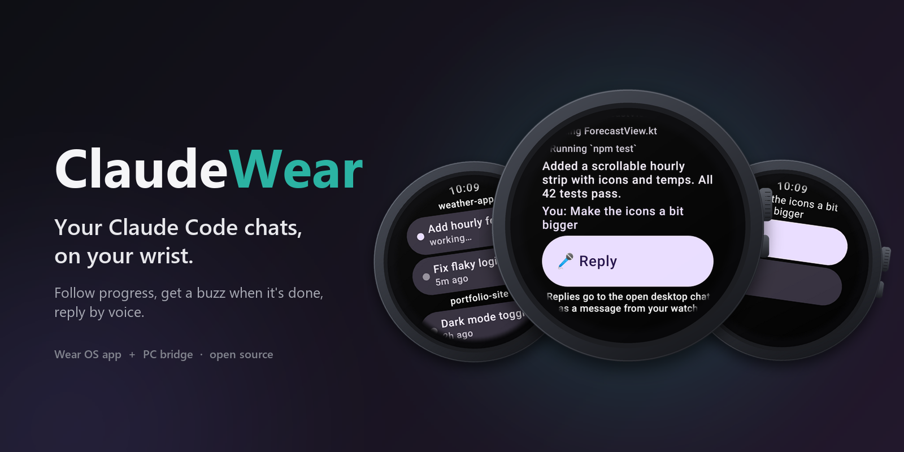
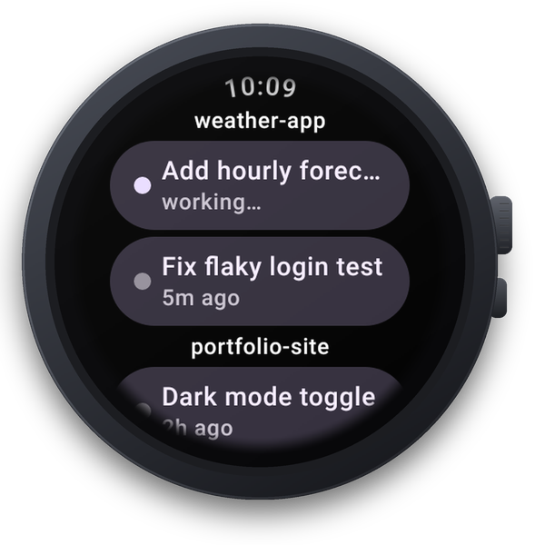
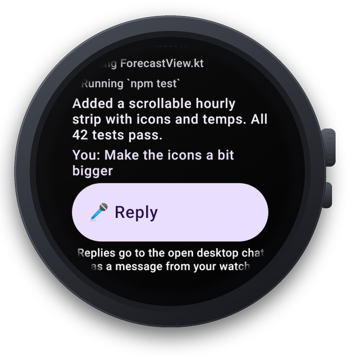
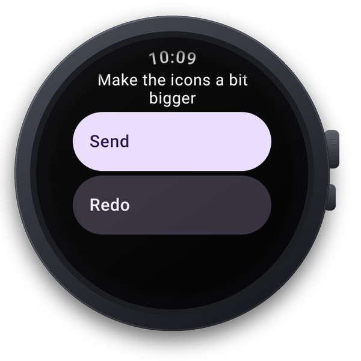
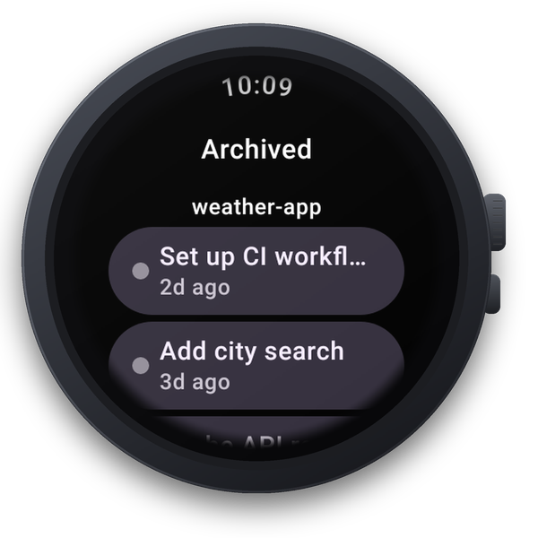
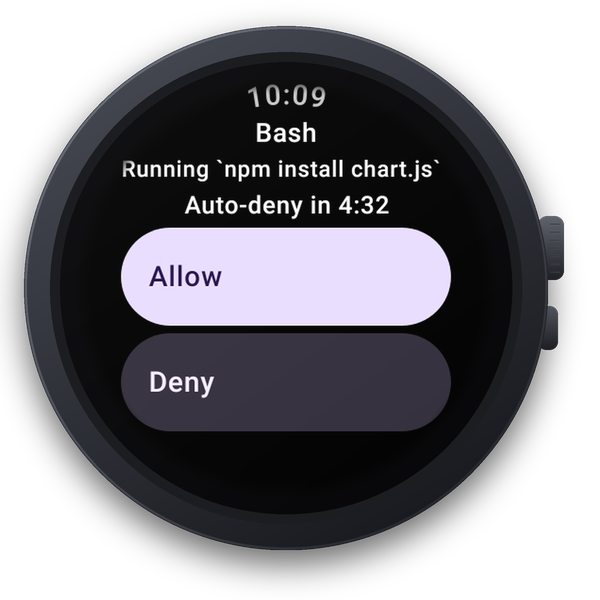
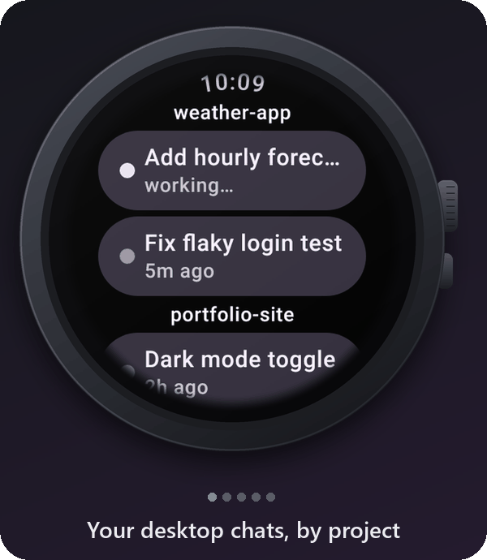
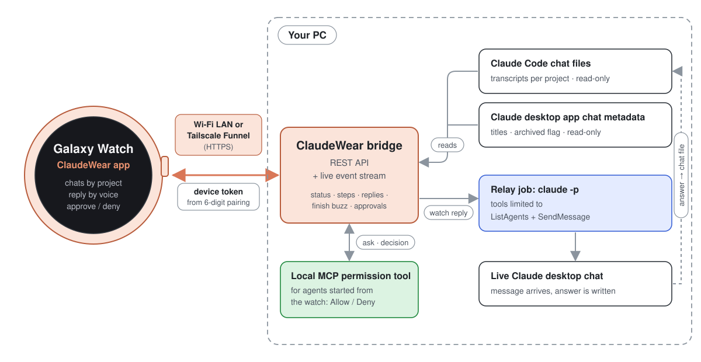
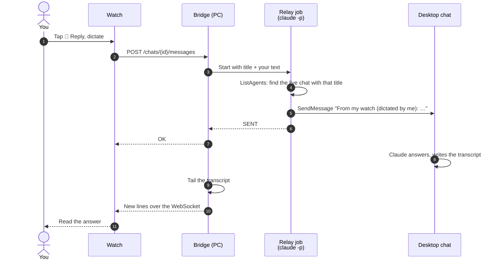

<p align="center">
  
</p>

<h1 align="center">ClaudeWear</h1>

<p align="center"><strong>Your Claude Code chats, on your wrist.</strong></p>

<p align="center">
  <a href="https://github.com/The3DFella/ClaudeWear/actions/workflows/ci.yml"></a>
  <a href="LICENSE"></a>
  
  
</p>

> [!IMPORTANT]
> **Unofficial community project.** ClaudeWear is not affiliated with, endorsed by or supported by Anthropic. "Claude" and "Claude Code" are trademarks of Anthropic. The project name may change.

ClaudeWear is a Wear OS app plus a small Node.js bridge that runs on your PC. The bridge reads your local Claude Code chats and talks to the `claude` CLI you've already signed in to; the watch shows what's going on and lets you answer. There's no cloud service in between: the watch talks straight to your PC.

## What it does

- **See your active Claude Code chats** from the desktop app, grouped by project, newest first.
- **Archived chats are tucked away** under their own chip, just like in the desktop app.
- **Live progress:** steps such as "Editing server.ts" or "Running `npm test`" and Claude's replies stream in as they happen.
- **A buzz when a chat finishes**, so you can walk away from your desk.
- **Reply by voice** into the open desktop chat. Claude answers there and you read the answer on your wrist.
- **Approve or deny tool use from your wrist** for the Claude Code agents the bridge runs.
- **Works at home over Wi-Fi, or anywhere via [Tailscale Funnel](docs/remote-access-tailscale.md).**

## Screenshots

| Home | Chat | Reply | Archive | Approval |
| :---: | :---: | :---: | :---: | :---: |
|  |  |  |  |  |

<p align="center">
  
</p>

## How it works

<p align="center">
  
</p>

- The **bridge** (`wearclaude-bridge`, Node.js) runs on your PC. It reads Claude Code's chat transcripts (read-only), tails them for new lines and pushes updates to the watch over a WebSocket.
- The **watch app** shows chats, buzzes when one finishes and sends your dictated replies.
- To **reply**, the bridge runs a tiny, locked-down `claude -p` job that uses Claude Code's cross-session messaging to drop your message into the open desktop chat:



## Requirements

| | |
| --- | --- |
| **Watch** | Wear OS 3+ (tested on Wear OS 5–6, Galaxy Watch 7). |
| **PC** | Windows, macOS or Linux with **Node.js 20+**. |
| **Claude Code** | CLI **2.1.316 or newer**, signed in with any Claude plan that includes Claude Code (Pro, Max, Team, Enterprise) or an API key. |
| **Claude desktop app** | Optional for viewing chats. Needed for chat titles, the archive and replying by voice. |
| **To build the watch app** | JDK 17 and the Android SDK (Android Studio has both), until a prebuilt APK is published on Releases. |

## Quickstart

The full walkthrough, with per-OS details and fixes for common snags, is in **[docs/setup.md](docs/setup.md)**.

**1. Install Claude Code and sign in.** Follow the [official setup guide](https://code.claude.com/docs/en/setup), then:

```sh
claude          # then type /login inside Claude Code
claude --version  # must be 2.1.316 or newer
```

**2. Get the code and build the bridge.** In a terminal, from the folder where you keep projects:

```sh
git clone https://github.com/The3DFella/ClaudeWear.git
cd ClaudeWear/bridge
npm ci
npm run build
npm link        # optional: puts `wearclaude-bridge` on your PATH
```

Without `npm link`, use `node dist/cli.js` instead of `wearclaude-bridge` (from the `bridge/` folder).

**3. Start the bridge.** In the same terminal (with `npm link` this works from any folder; otherwise stay in `ClaudeWear/bridge` and run `node dist/cli.js`):

```sh
wearclaude-bridge
```

It checks Claude Code, then prints your LAN address (such as `http://192.168.1.23:8787`) and a 6-digit pairing code that's valid for 5 minutes. Leave it running. On Windows, allow Node.js through the firewall on **Private** networks when asked.

**4. Build the watch app.** In a second terminal, from the `ClaudeWear` folder (leave the bridge running in the first). Point the build at the Android SDK with `ANDROID_HOME` or `watch/local.properties` (`sdk.dir=…`), and use JDK 17.

macOS / Linux:

```sh
cd ClaudeWear/watch
./gradlew :app:assembleDebug
```

Windows (PowerShell):

```powershell
cd ClaudeWear\watch
.\gradlew.bat :app:assembleDebug
```

**5. Sideload it over wireless debugging.** On the watch: Settings > About watch > Software information, tap **Software version** five times, then Settings > Developer options > turn on **ADB debugging** and **Wireless debugging** > **Pair new device**. On the PC, from the `ClaudeWear/watch` folder (`cd ClaudeWear/watch`; on Windows `cd ClaudeWear\watch`):

```sh
adb pair <watch-ip>:<pairing-port>    # enter the code shown on the watch
adb connect <watch-ip>:<port>         # the port on the main Wireless debugging screen
adb install -r app/build/outputs/apk/debug/app-debug.apk
```

**6. Pair.** Open **ClaudeWear** on the watch, allow notifications, enter the bridge address (for example `192.168.1.23:8787`) and the pairing code, and tap **Pair**. Need a fresh code? Run `wearclaude-bridge pair`.

That's it. Your chats appear on the watch.

> **About the names.** The display name is **ClaudeWear**, but some internal identifiers keep the original spelling so existing installs keep working: the `wearclaude-bridge` command, the `~/.wearclaude` data folder and the Android package `dev.wearclaude.watch`. See [docs/RENAMING.md](docs/RENAMING.md).

## Using ClaudeWear

More detail for every screen is in **[docs/usage.md](docs/usage.md)**.

- **Home.** Active PC chats grouped by project. Each shows **working…** or when it was last active. An "approvals waiting" chip appears at the top when something needs you, and **Archived (N)** at the bottom.
- **Archive.** Chats you archived in the desktop app, grouped the same way.
- **Chat.** The latest messages: your prompts, Claude's replies and steps (`↳ Editing server.ts`). It follows along live while the chat works.
- **Reply by voice.** Tap **🎤 Reply**, speak, tap **Send**. The message lands in the open desktop chat as "From my watch (dictated by me): …" and Claude's answer streams back. Limits:
  - the chat must be **open in the Claude desktop app** and have a title (two open chats with the same title must be renamed apart);
  - Claude treats it as a request from another session, so it **can't approve permission prompts** (those stay on the PC);
  - one message per chat at a time, three at most overall;
  - each reply costs **one small extra Claude call** for the relay job.
- **Approvals.** For agents the bridge runs in a project you added with `wearclaude-bridge add-project`: see the tool and what it wants to do, then **Allow** or **Deny**. Unanswered requests are denied after 5 minutes.
- **Notifications.** A buzz when a working chat finishes ("<title> finished"), and an urgent buzz for approvals. Tap to jump straight there.

## Remote access

At home the watch reaches the bridge over Wi-Fi with plain http. Away from home, share the bridge's main port with **Tailscale Funnel**:

```sh
tailscale funnel --bg 8787
tailscale funnel status     # shows https://<machine>.<tailnet>.ts.net
```

Pair the watch with that `https://…ts.net` URL. It works at home too. The URL is public, protected only by the device token, so revoke lost watches with `wearclaude-bridge devices revoke "<name>"`. Never expose ports 8788 or 8789. Full guide: **[docs/remote-access-tailscale.md](docs/remote-access-tailscale.md)**.

## Privacy and security

- **What the bridge reads:** Claude Code transcripts under `~/.claude/projects` (read-only; only the start and end of large files plus new lines), and, if the desktop app is installed, just the id, title, archived flag and last-activity time from its per-chat metadata. It **never reads Claude credentials** or login files, and never reads `ANTHROPIC_API_KEY`; it runs the unmodified `claude` program, which you signed in to yourself.
- **What leaves your PC:** only what the watch shows (chat titles, project folder names, message text and steps), sent straight to your paired watch. Message text is shown as-is and can include file paths. Replying runs Claude Code as usual, which talks to Anthropic like any other Claude Code use. There's no ClaudeWear server and no telemetry.
- **Device token:** pairing swaps a 5-minute, single-use, 6-digit code for a long random token. The PC stores only its hash. Every request (including the WebSocket) sends it as an `Authorization: Bearer` header, never in a URL. Five wrong codes lock pairing for 5 minutes.
- **Local-only admin:** `wearclaude-bridge pair` and `devices` talk to an admin listener on `127.0.0.1` (port 8789) that needs a per-run secret and rejects proxied requests. The approval listener (8788) is also loopback-only.
- **Relay restrictions:** reply jobs can use exactly two tools (`ListAgents`, `SendMessage`), load no MCP servers, run in a temp folder, aren't saved as chats, and are told to treat your text as data.
- **LAN traffic is unencrypted http.** Use it only on Wi-Fi you trust; use Tailscale anywhere else.
- **Bridge-run agents:** only add projects you trust. `claude -p` runs a project's hooks and `.mcp.json` without asking.

See [SECURITY.md](SECURITY.md) for the threat model and how to report a vulnerability privately.

## Limitations

- **Replies only reach chats that are open in the Claude desktop app.** For other chats, reply from your PC or the Claude phone app (Remote Control).
- **Claude treats a relayed message as a teammate's request**, not as typed by you. It can't approve permission prompts.
- **Relay delivery can't be independently confirmed.** If a send times out, check the chat before retrying; it may have arrived.
- **Undocumented formats.** Claude Code transcripts and the desktop app's chat metadata aren't official APIs. A Claude Code update could break chat listing or titles until ClaudeWear catches up. Unknown lines are skipped, not fatal.
- **No push notifications.** Buzzes come from a background service that runs while something is working and stops about a minute after everything is idle. If the app is fully closed and nothing is running, you won't be notified until you open it.
- **One bridge per watch.** A watch pairs with one PC at a time.
- **Starting brand-new tasks from the watch** isn't on Home in this release; ClaudeWear is focused on the chats you already have.
- **Build it yourself** for now: there's no Play Store listing or release APK yet.
- **Tested on one watch** (Galaxy Watch 7). Other Wear OS 3+ watches should work but haven't been tried.

## Troubleshooting

Quick fixes for the most common problems. The full list is in **[docs/troubleshooting.md](docs/troubleshooting.md)**.

| You see | Try |
| --- | --- |
| "Can't reach your PC" | Same Wi-Fi? Firewall allows port 8787 (Windows: Private network)? Does `http://<pc-ip>:8787/health` open on your phone? |
| "Wrong or expired code" | Codes last 5 minutes and work once. Run `wearclaude-bridge pair` for a new one. |
| "Too many tries — wait 5 minutes" | Wait 5 minutes, then use a fresh code. |
| "Open this chat in the Claude desktop app, then try again" | Open that chat in the desktop app and send again. |
| "Several open chats have this title — rename one on your PC" | Rename one of the chats with the same title. |
| No buzz in the background | Allow notifications; open the app once after starting a long task. |
| Wireless debugging keeps turning off | Turn it back on and `adb connect` to the new port. |
| ``Not signed in. Run `claude`, then type /login.`` | Run `claude`, type `/login`, restart the bridge. |
| "Usage limit reached" | Your Claude plan's limit was hit; wait for it to reset. |

## Development

```text
bridge/   Node.js + TypeScript bridge (Fastify, WebSocket, MCP approval server)
watch/    Wear OS app (Kotlin, Jetpack Compose for Wear OS, Gradle)
docs/     Setup, usage, configuration, troubleshooting, design notes
```

Run the tests:

macOS / Linux, from the repository root:

```sh
(cd bridge && npm ci && npx tsc --noEmit && npx vitest run)
(cd watch && ./gradlew :app:testDebugUnitTest)
```

Windows (PowerShell), from the repository root:

```powershell
cd bridge; npm ci; npx tsc --noEmit; npx vitest run; cd ..
cd watch; .\gradlew.bat :app:testDebugUnitTest; cd ..
```

Run the bridge from source with `npm run dev` in `bridge/`. Design notes live in [docs/design/](docs/design/). Contributions are welcome: see [CONTRIBUTING.md](CONTRIBUTING.md) and the [Code of Conduct](CODE_OF_CONDUCT.md). Bridge details: [bridge/README.md](bridge/README.md). Config reference: [docs/configuration.md](docs/configuration.md). Changes: [CHANGELOG.md](CHANGELOG.md).

## License

[MIT](LICENSE).

## Acknowledgements

- [Claude Code](https://code.claude.com) by Anthropic, which does all the real work. ClaudeWear just carries it to your wrist.
- [Fastify](https://fastify.dev), [ws](https://github.com/websockets/ws) and the [Model Context Protocol SDK](https://github.com/modelcontextprotocol/typescript-sdk) on the bridge.
- [Jetpack Compose for Wear OS](https://developer.android.com/training/wearables/compose) and [OkHttp](https://square.github.io/okhttp/) on the watch.
- [Tailscale](https://tailscale.com) for painless remote access.
