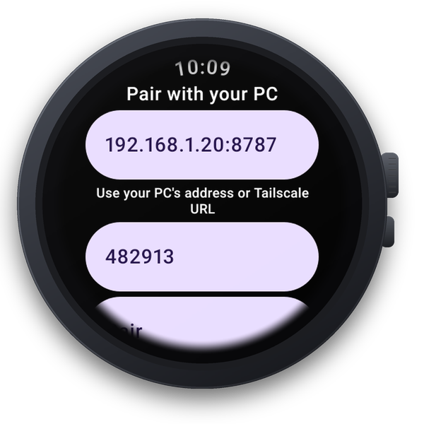
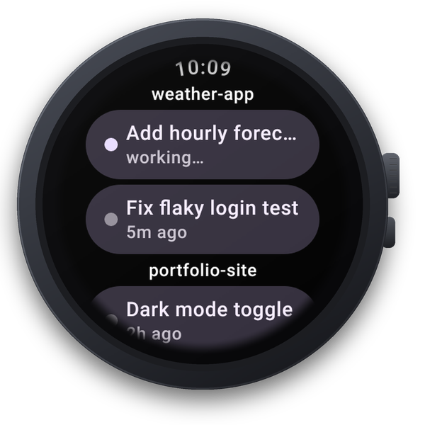
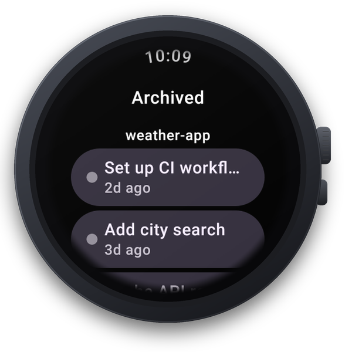
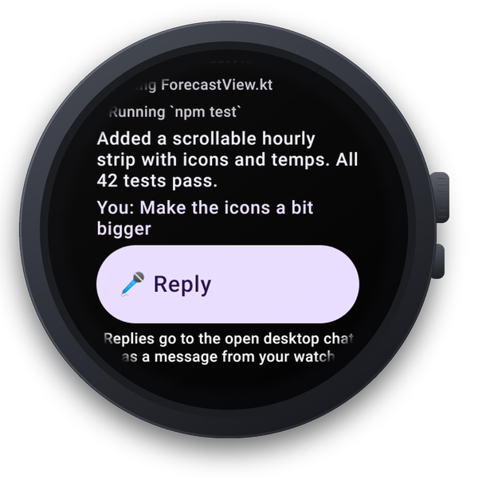
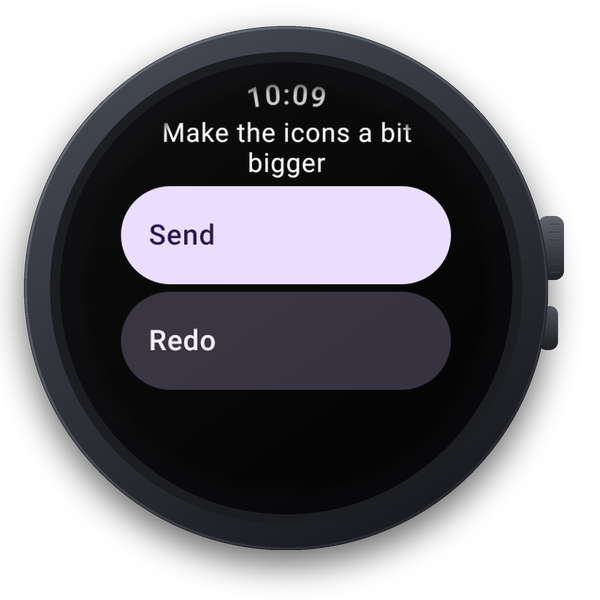
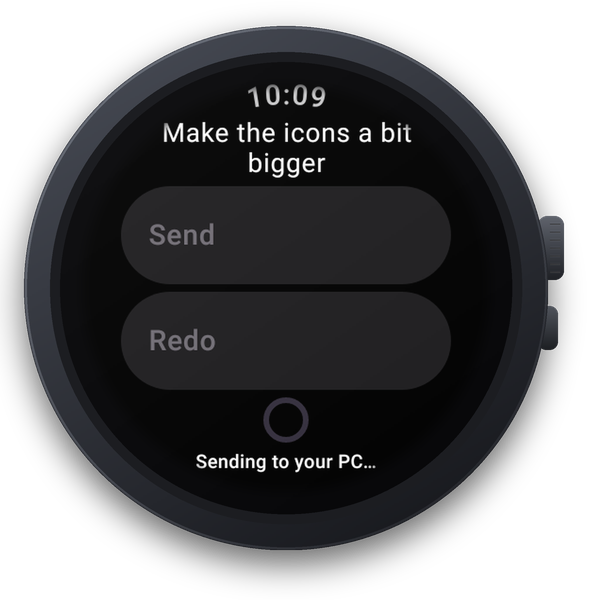
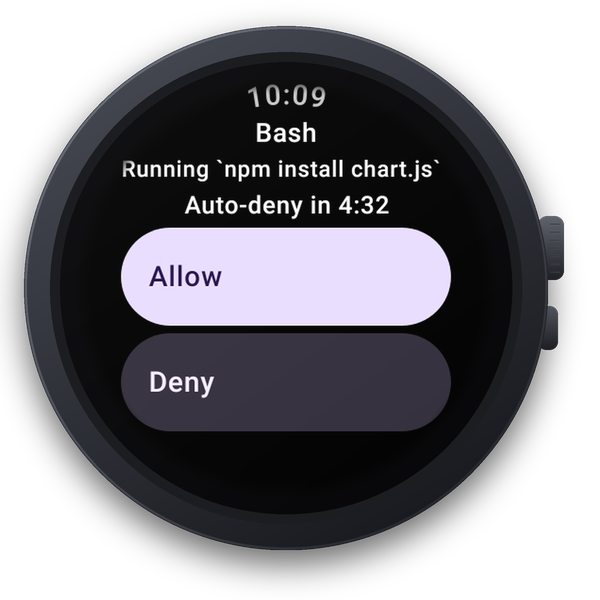

# Using ClaudeWear

A tour of every screen on the watch. Swipe right to go back from any screen; scroll with the crown or a swipe.

- [Pairing](#pairing)
- [Home](#home)
- [Archive](#archive)
- [Chat](#chat)
- [Reply by voice](#reply-by-voice)
- [Approvals](#approvals)
- [Notifications and buzzes](#notifications-and-buzzes)
- [Status and connection](#status-and-connection)

## Pairing



The first time you open ClaudeWear (and after a watch is revoked) you see **Pair with your PC**.

1. **Enter address.** The bridge's LAN address, such as `192.168.1.23:8787`, or your Tailscale URL. The hint underneath reads "Use your PC's address or Tailscale URL".
2. **Enter 6-digit code.** The code printed by `wearclaude-bridge` or `wearclaude-bridge pair`.
3. **Pair.** The button is enabled once both are filled in.

How the address is completed when you leave out `http://` or `https://`:

| You type | Becomes |
| --- | --- |
| An IPv4 address, `localhost`, or a name ending in `.local` | `http://…` |
| Anything else (for example `mypc.tailnet.ts.net`) | `https://…` |

Errors you may see are explained in [troubleshooting.md](troubleshooting.md#pairing).

<br clear="right">

## Home



Home lists your **active Claude Code chats on the PC**, newest first, grouped under their project folder name.

- Each chip shows the chat title and either **working…** (with a coloured dot) or how long ago it was last active, such as `5m ago`, `3h ago`, `2d ago`.
- Titles come from the Claude desktop app's sidebar when available. Otherwise the chat's custom title or its first prompt is used.
- Chats from the last 30 days are shown, up to 100. Change the window with `pcChatsMaxAgeDays` ([configuration.md](configuration.md)).
- If approvals are waiting, a **N approval(s) waiting** chip sits at the top.
- If there are archived chats, an **Archived (N)** chip sits at the bottom.
- With no chats you'll see "No active chats on your PC".

Home updates live. You don't need to refresh.

<br clear="right">

## Archive



Chats you archived in the Claude desktop app are kept out of the way on **Archived**, grouped by project the same way as Home (up to 50). Tap one to open it. Unarchive it on the PC to bring it back to Home.

The archived state comes from the desktop app's metadata. If that isn't available, or `useDesktopMetadata` is off, every chat counts as active and this chip doesn't appear.

<br clear="right">

## Chat



Tap a chat to see its title, project and the most recent messages (up to 60):

- `You: …` lines are your prompts (highlighted).
- `You (watch): …` lines are messages you dictated from the watch.
- `↳ …` lines are steps, such as `↳ Editing server.ts`, `↳ Running npm test`, `↳ Searching`.
- Plain lines are Claude's replies.

While the chat is working, new lines appear as they're written and the screen follows the end.

At the bottom you'll see either:

- **🎤 Reply**, if the chat has a title, with the note "Replies go to the open desktop chat as a message from your watch", or
- "Read-only — reply from your PC or the Claude phone app", if the chat has no title yet.

Message text is shown as Claude Code wrote it, so it can include file paths.

<br clear="right">

## Reply by voice



Tap **🎤 Reply** on a chat. The watch's speech recognizer opens right away.

- When it finishes, your words appear on screen. Tap **Send**, or **Redo** to dictate again.
- If nothing was heard, or the watch has no speech recognizer, you'll see "Nothing heard" and a **Type instead** button for the keyboard.



After you tap Send the watch shows "Sending to your PC…". This normally takes a few seconds and can take up to about 90. Then you return to the chat, where Claude's answer streams in.

**What happens:** the bridge starts a short, locked-down `claude -p` job on your PC. That job lists the live Claude Code sessions, finds the one whose title matches this chat, and sends your text to it with Claude Code's cross-session messaging. The desktop chat receives:

```
From my watch (dictated by me): <your words>

Reply here in this chat as usual — I'm reading this chat on my watch. Don't message the sender back; it has already closed.
```

Claude answers in the desktop chat, the answer is written to the transcript, and the bridge streams it to the watch.

<br clear="right">

**Limits, honestly:**

- **The chat must be open in the Claude desktop app** and running. Closed chats can't receive messages.
- **It needs a title.** If two open chats have exactly the same title, the bridge refuses rather than guess. Rename one.
- **Claude treats it as a message from another session** (like a teammate's request), not as something you typed. It can't approve anything, and permission prompts still appear on the PC.
- **One message per chat at a time**, at most three in flight overall.
- **Each reply costs one small extra Claude call** on your plan, for the relay job.
- **Delivery can't be independently confirmed.** The bridge trusts the relay job's report. If a send times out, the message may still have arrived, so check the chat before sending again.

For chats that aren't open in the desktop app, reply from your PC or the Claude phone app (Remote Control).

Errors you may see are listed in [troubleshooting.md](troubleshooting.md#reply-by-voice).

## Approvals



Approvals are for Claude Code runs that **the bridge itself starts**, in a project you added with `wearclaude-bridge add-project`. When such a run wants to use a risky tool, the watch buzzes and opens the approval screen:

- The tool name (for example `Bash`) and a short description (for example ``Running `npm test` ``).
- A countdown, "Auto-deny in 4:59". When it reaches zero it shows "Expired" and the request is denied.
- **Allow** or **Deny**.

If you answer on another device, or it times out first, you'll see "Already answered" and the screen closes.

Your **desktop chats are not affected**: their permission prompts stay on the PC, and a message relayed from the watch can't approve them.

The timeout is `approvalTimeoutSec` (default 300 seconds). `defaultPermissionMode: "acceptEdits"` lets those runs edit files without asking. See [configuration.md](configuration.md).

<br clear="right">

## Notifications and buzzes

ClaudeWear asks for permission to show notifications the first time it opens. Without it, everything still works but you won't get buzzes.

| Notification | When | Channel |
| --- | --- | --- |
| **"<chat title> finished"** with the project name | A PC chat that was working finishes its turn | Agent updates |
| **"Approve: <tool>"** | A bridge-run agent needs approval | Approvals |
| Done / Failed with a short summary | A bridge-run agent finishes or fails | Agent updates |
| **ClaudeWear** ongoing notification, such as "1 PC chat working" or "Watching for finished chats" | While the background service runs | Background connection |

Tapping a notification opens the matching chat or approval.

**How long it keeps watching.** While ClaudeWear is open, a finished chat gives a short buzz. When you leave the app, a background service takes over and a finished chat posts a notification instead. The service starts when you send a reply or start something from the watch, and whenever you leave the app. It keeps watching while any chat or agent is working and for 15 minutes after you leave the app or after the last thing finished, then stops by itself. Android limits this kind of background time to about 6 hours a day. There is no push service, so if the watch restarted or the service was stopped, open ClaudeWear once to resume watching.

A chat that just goes quiet (no output for a while) is shown as idle but doesn't buzz. Only a real end of turn does.

## Status and connection

- **Reconnecting…** at the top of Home means the live connection dropped. The watch retries on its own (after 1, 2, 5, 10 and then every 30 seconds) and catches up on what it missed.
- **This watch was removed — pair again** means the device was revoked on the PC (or its token is no longer valid). Pair again with a new code.
- If the bridge restarts, the watch notices and reloads everything.
